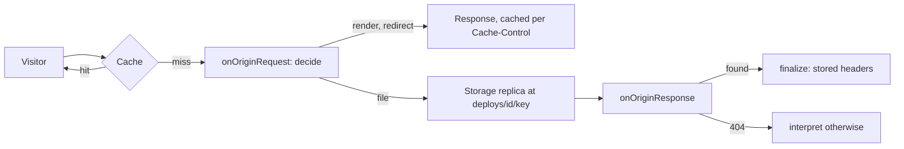

# Design

How `astro-adapter-bunny` is built: an Astro 7 adapter for bunny.net Edge Scripting, written from scratch. Decisions are recorded in `docs/adr/`, the order of work in `docs/plan.md`, the test strategy in `docs/testing.md`. Each ADR carries its own status; a section here marked **(accepted)** follows a user decision, everything else is proposed.

Claims that rest on research tagged expected or open carry a marker: **[E: ref]** or **[open: ref]**, where `ref` points at `docs/research/` (`bunny` open question n, `astro` open question, `contract` open question n) or at a spike step in `docs/plan.md` (L1, L2, S1). Everything unmarked is verified in the research.

## Goals

- Replace the reference site's vendored adapter with an import and options change, plus moving its header baseline into `public/_headers` (requirements: Must rows).
- Both script types, **standalone** and **middleware**, with identical routing, headers and caching.
- One pure function decides what a request becomes, so routing is tested without a runtime.
- A file in storage wins over a dynamic on-demand route, including files written by integrations after the adapter (R-ROUTE-2).
- No response ever leaves without `Cache-Control` (bunny caches it 30 days otherwise).
- Far fewer options than a typical adapter: two.
- Nothing is fetched from third parties at runtime; the package works with `npm ci --ignore-scripts` (G-10, the reference site's rules).

## Non-goals for v1

- Deploying. Zone names, environments, purges, rollback and retention belong to the deploy tool. The adapter only declares what its runtime needs.
- Running before the cache (`onClientRequest`). It costs a script run per cache hit.
- A default session driver, a cache provider, a Bunny Optimizer image service (ADR 0006).
- `i18n.domains` (marked unsupported until forwarded host handling is verified).

## The core idea, critiqued

The proposal: one pure function per request returns a decision (render, redirect, stored file, miss), and each script type is a thin translation of that decision.

**What holds.** The two script types differ only in how they are entered (`serve` versus `registerMiddlewares`) and how a stored file is reached (rewrite to the origin versus a Storage API read). Everything else (base, trailing slash, `build.format`, method rules, which routes may claim a path, not-found order, `_redirects`) is the same and is pure.

**What does not hold, and the fix.** A pure function cannot know whether a file exists. A build-time file list misses files written after the adapter's hook (the reference site's bug), and asking storage inside the function makes it impure. So the decision is data that contains the miss: a stored-file decision carries what to do when the file is absent.

```ts
type Decision =
  | { type: "render" }
  | { type: "redirect"; status: number; location: string }
  | { type: "file"; key: string; status?: 404; otherwise: Decision };
```

Each script type interprets `file` with its own I/O and, on a 404 from storage, interprets `otherwise`. A catch-all route never gets a path before storage has said it has no file there (ADR 0002).

**What the function does not do.** Route matching. `decide` never calls `app.match()`: the match comes in as a function argument. At runtime `app` backs it with `app.match(request, true)`: without the second argument Astro treats redirects as prerendered and answers them with 404 (L1 step 3); in unit tests a table backs it, so collisions such as `[locale]` against `/sitemap-index.xml` are unit tests with no Astro build.

## Module map

Organized by domain, named as Astro and bunny.net name things.

| Module | Responsibility | Interface (sketch) | Hides |
| --- | --- | --- | --- |
| `routing` | What a request becomes | `decide(request, site, match): Decision` | `base`, `trailingSlash`, `build.format` to storage key, `build.assets` prefix, method rules, reserved paths, `_redirects` rules, not-found order |
| `caching` | Headers on every response leaving the script | `finalize(response, origin: "rendered" \| "stored" \| "adapter", headersFor?): Response` | `Cache-Control` defaults, immutable assets, the `Set-Cookie` and `Vary` rule, applying `_headers` to stored files through a lookup function, never overwriting |
| `app` | Astro's `App` in this isolate | `match(url)`, `render(request, kind)` | `createApp()` once, `app.match(request, true)` so redirect routes match, `setGetEnv`, `clientAddress` from `x-real-ip`, `waitUntil`, cookie headers, error pages read through `storage` |
| `platform` | Every bunny.net global | `deploy()`, `env(name)`, `waitUntil(p)`, `visitorUrl(request)` | `globalThis.__BUNNY_DEPLOY__` read lazily on first use, `Bunny.v1`, `Deno.env`, rebuilding the URL from `cdn-host` and `https` |
| `storage` | Read one file of this deploy through the Storage API | `readFile(key, request): Promise<Response \| undefined>` | Storage API host, `AccessKey`, deploy prefix, path safety, one place that builds storage URLs, conditional header passthrough, `Content-Type` from the extension, a 401 or 403 logged once per isolate |
| `packed-loader` | Load server code packed in the script | the bundle's `import()` calls resolve through it | SystemJS `s.js`, the table of packed chunks, the hook that decodes with `Uint8Array.fromBase64`, decompresses with `DecompressionStream('brotli')` and evaluates on first import |
| `scripts/middleware` | Middleware entry | none; registers `onOriginRequest` and `onOriginResponse` | Carrying the visitor path between hooks, rewriting to the origin, catching every throw |
| `scripts/standalone` | Standalone entry | none; calls `serve` | Calling `storage`, catching every throw |
| `build` | The Astro integration | `bunny(options?): AstroIntegration` | `setAdapter` fields, build output detection from the server entry, virtual module, forced config (`build.redirects: false`, `vite.ssr.noExternal`, the Sharp split of ADR 0006), parsing `_headers` and `_redirects`, Astro redirects appended to `_redirects` in static builds, `requires.env` from the env schema, `.bunny/build.json` |
| `build/bundle` | Server code to one script | `bundle({ dir, entry }): Promise<ServerOutput>` | A Rollup pass over Astro's server output to `System.register`, with Rollup's default chunking, which chunks are eager, stripping server files from `entryModules`, the Shiki wasm rewrite, minify with Rolldown's minifier, brotli and base64 packing, the source map, script size and builtin checks |
| `preview` | `astro preview` | Astro's `previewEntrypoint` contract | A local Node server running the built script against `dist/client` |

Notes:

- `routing` and `caching` are pure and import nothing from Astro or bunny.net. `caching` gets `_headers` as a lookup function; the runtime never parses a file.
- `platform` is the only module that reads a global. Tests replace it.
- `storage` and `packed-loader` are used by both script types. Only `build/bundle` and `packed-loader` know that chunks are packed (ADR 0007).

## Request flow

### Decision table (`routing`)

Input: method, the visitor's path and query, the site facts from the build, and `match`. Rows are checked in order; the first that applies wins.

| # | Request | Decision |
| --- | --- | --- |
| 1 | Path outside `base` | `file 404.html (404)`, otherwise `render` |
| 2 | Path under `build.assets` (`/_astro/`) | `file`, otherwise not found (never rendered) |
| 3 | Reserved path: `/_bunny/`, `/_headers`, `/_redirects` | not found |
| 4 | Not GET or HEAD | `render` (bodies never go to storage) |
| 5 | Matches an on-demand route with a fixed pathname | `render` |
| 6 | Matches a redirect route | `render` (Astro answers with the configured status) |
| 7 | Matches an on-demand route with params | `file` at the mapped key, otherwise `render` |
| 8 | Matches a `_redirects` rule | the rule's redirect, or for status 200 a `file` at the target |
| 9 | Matches nothing on demand | trailing slash redirect if Astro's rule asks for one, else `file` at the mapped key, otherwise not found |

"Not found" is `file 404.html (404)` when the 404 page is prerendered, else `render`. Key mapping: a last segment with a dot is literal; otherwise `p/index.html` (`directory`) or `p.html` (`file`). One key per request, so one storage read at most.

`_redirects` sits after every on-demand row, so it only covers paths no on-demand route claims. A redirect from a path a dynamic route answers goes in Astro's `redirects` config (ADR 0008).

### Middleware



- `onOriginRequest` rebuilds the visitor URL from `cdn-host`, since `request.url` is the storage origin there.
- A `file` decision returns a `Request` rewritten to `<assetPrefix>/<key>`; the visitor's `/deploys/...` is prefixed again and 404s (R-TYPE-2).
- The visitor path travels to `onOriginResponse` in a reserved query parameter on the rewritten URL, with a request header as fallback (proposed). S1 step 4 measured that the hook sees the rewritten URL and the header, storage ignores the query, and the cache key stays the visitor URL.
- Both hooks catch everything and answer a `private, no-store` 500, since a throw gives an empty 500 with no fall-through.

### Standalone

- `serve(handler)`: decide, then for `file` read `<assetPrefix>/<key>` through `storage`; on 404 interpret `otherwise`.
- `storage` sets `Content-Type` from the file extension (proposed), since a Storage API read answers `application/octet-stream` for `.webmanifest` and extensionless files (S1 step 6).
- `request.url` is already the public URL in standalone (S1 step 5). The CDN strips `Range` and `If-*` and turns HEAD into GET before the script (S1 step 5), so conditional and range requests are answered by the CDN.

### Shared by both

- **Server code.** Everything is in the script; nothing is fetched for code (ADR 0007, accepted). The eager chunks run at import. The first request that imports a lazy chunk has `packed-loader` unpack and evaluate it; later requests in the isolate reuse the module.
- **Deploy global.** `platform` reads `__BUNNY_DEPLOY__` on the first request, never at import, because a deploy tool's compat probe imports the raw script. Missing: a `private, no-store` 500, one log line naming the cause, no storage read. **(accepted)**
- Rendered responses get `clientAddress` from `x-real-ip`, `waitUntil` from `Bunny.v1.waitUntil`, cookies appended, and `prerenderedErrorPageFetch` reading `404.html` and `500.html` through `storage`, never `fetch()` to self.
- Every exit passes `caching.finalize`, storage 401, 403 and 5xx included (ADR 0005, proposed).
- The adapter logs no request data: no URLs with queries, cookies, IPs or bodies.

## Build flow

1. `astro:config:setup`: register the virtual module with build facts. Force `build.redirects: false`, `vite.ssr.noExternal: true`, and the Sharp split when the project uses the default service (ADR 0006).
2. `astro:config:done`: read `buildOutput` before `setAdapter()` and pass it back (ADR 0003). Turn on `staticHeaders` only when `buildOutput` is `"server"` **(accepted)**. Declare `envGetSecret: stable`, `sharpImageService: limited`, `i18nDomains: unsupported`. Derive `requires.env` from `env.schema` **(accepted)**. Log the script type in one line **(accepted)**.
3. `astro:build:setup`: point the server environment at the script type's entry.
4. `astro:build:generated`: take `routeToHeaders` and merge it with `_headers` into one table, per-page headers first.
5. `astro:build:done`: parse `_headers` and `_redirects` from `dist/client` (ADR 0008). When Astro emitted a server entry, whatever `buildOutput` said (a prerendered site with a `server:defer` island, L1 step 1), run `build/bundle` (one packed `dist/index.js` with its source map) and check script size and `node:` imports. Otherwise append Astro's redirects to `dist/client/_redirects` and warn when `_headers` and `_redirects` exceed 50 rules. Write `.bunny/build.json`.

No file list is written: static-first lookup does not need one.

## Options

| Option | Type, default | Why it exists |
| --- | --- | --- |
| `script` | `"middleware" \| "standalone"`, default `"middleware"` **(accepted)** | The two types need different zone setups. Middleware reads storage replicas for static misses (about 85 ms against 420 ms from New York). The type is fixed once the Edge Script exists: the API accepts a change and ignores it (S1 step 10). |
| `staticCacheControl` | `string`, default `"public, max-age=0, must-revalidate"` **(accepted)** | `Cache-Control` for stored files outside `build.assets`. A consumer may opt into `s-maxage`, which needs a purge on publish and on rollback. |

Removed against the reference site's current adapter, each with the reason:

- `headers` **(accepted)**: `public/_headers` with a `/*` block does the same for stored files, and also works for static builds through the deploy tool (ADR 0008).
- `sessions`: Astro's own `session: false` already says it.
- `assetManifest`: static-first lookup makes the file list unnecessary.
- `imageService`: out of scope for v1 (ADR 0006).
- `BunnyRuntime` and `locals.runtime`: nothing reads it.
- No size, split or minify option: server code is always packed into one minified script **(accepted)**, and the limits are bunny's.

## What the build emits for deploy tools

- `dist/index.js` **(accepted)**: the one script, as in the bunny CLI's examples. Holds the entry, `routing`, `caching`, `s.js`, the eager chunks, the packed lazy chunks and the header table (ADR 0007).
- `dist/index.js.map`: the source map, next to the script and not deployed **(accepted)**.
- `dist/client/`: every static file, prerendered pages, `_headers` and `_redirects` as written. No server code.
- `.bunny/build.json`, version 1 plus optional fields readers ignore (ADR 0004): `kind`, `script.{entry,type,bytes}`, `assets.dir`, optional `assets.immutable: ["_astro/"]`, `requires.pullZone`, `requires.env` with the storage variables required in both types and the app's server secrets.
- Settings the adapter cannot express in v1 (`CacheControlMaxAgeOverride: -1`) go in the README as deploy requirements.

## How the reference site migrates

After the packed script milestone and the first release, not before **(accepted)**.

| Reference site today | After |
| --- | --- |
| `import bunny from "<vendored package>"` | `import bunny from "astro-adapter-bunny"` |
| `script: "middleware"` | unchanged (also the default) |
| `sessions: false`, `assetManifest: false` | removed; `session: false` in Astro config stays |
| `pageCacheControl` | `staticCacheControl`, same value |
| `headers` | its response headers module writes `public/_headers` with a `/*` block; its middleware keeps owning rendered responses |
| CSP with `frame-ancestors` in `headers` | lost on prerendered pages, since Astro's per-page CSP wins over `_headers`; must be re-added in Astro's CSP config |
| `BunnyRuntime` in its env type declarations | line removed |
| its deploy tool | no change: it reads the same v1 fields and already sets the storage variables |
| its Shiki stub | removed; Shiki is packed into the script |

Proof: the reference site's builds deploy through its own deploy tool with its smoke tests, plus the checks of `docs/testing.md`.

## Clean room

This adapter is written without reading any other bunny.net adapter.

- **Never read** the source, tests, history or `node_modules` copies of: the reference site's vendored adapter, BunnyWay's adapter repositories, any `@bunny.net/*-adapter` package, or the prototype's adapter code. Not the git history of this repository from before the rewrite either.
- **Allowed**: Astro's documentation and the compiled `astro` package; official Astro adapters for patterns, described in your own words; bunny.net documentation, SDK types and CLI; Rollup and SystemJS; the reference site's docs, config and deploy code; `docs/research/`.
- **Describe, do not copy.** Prior art reaches this repository only as behavior-only reports.
- **If you read a forbidden source by accident**, say so in your PR and step away from the module it concerns.

## Risks

| Risk | Effect | Mitigation |
| --- | --- | --- |
| Packed script outgrows what bunny.net starts **[open: M3]** | Every request 400 or slow cold starts | Size check on the whole script: warn above 1 MB, fail above 7 MB (ADR 0007); about 25 MB of source expected to fit, not measured; a build the size of the reference site is measured in M3 |
| A request fails on subrequests **[open: M3]** | A cold route fails | No code is fetched any more; S1 saw 400 sequential fetches in one request succeed; a guard only if a request can fail |
| Shiki changes how it inlines its wasm | Shiki decodes 622 kB of base64 per cold request again, about 48 to 68 ms on `/code` (S1 pack tune, derived) | The build skips the rewrite when the pattern is missing, so the site still renders, only slower |
| `<Prism>` in an on-demand route fails at request time | prismjs loads its languages through a dynamic `require` the bundler cannot see | Its own pull request: a Vite plugin that makes the language loads visible to the bundler (plan) |
| Rollup and SystemJS as dependencies | A larger dependency tree, a native binary for Rollup | Accepted (G-10 reworded); CI installs with `npm ci --ignore-scripts` |
| Every on-demand request under a catch-all pays a storage miss first **[E]** | Slower catch-all pages | Measured in M4 and M5; an optional file table is a later, additive change |
| Some `node:` builtins break startup (measured: `child_process`, `vm`, `worker_threads`, `constants`, `path/win32`) | Every request 400 | The build refuses them (ADR 0007) |
| `max-age=0` pages revalidate at storage on every request | 275 ms per HTML request on the reference site | Opt-in `s-maxage` with purges; R-HDR-7 |
| `ASTRO_KEY` for server islands is read at build **[E]** | A key in the bundle, against R-BUILD-6 | Check in M2; document |
| The server output holds absolute paths of the build machine **[open]** | The project root and `node_modules` paths end up in the deployed script (L1) | Not checked yet whether Astro can avoid it |

## Open questions

1. Where the packed script stops starting, how a build the size of the reference site behaves, and whether a request can fail on subrequests (M3, ADR 0007).
2. Which Cloudflare `_redirects` and `_headers` features a static deploy can express as edge rules. The deploy tool owns that answer; the adapter warns only on the rule count (ADR 0008).
3. What `astro preview` runs: the real packed script against `dist/client` (proposed), or the ES modules before the Rollup pass (decided in M6).
